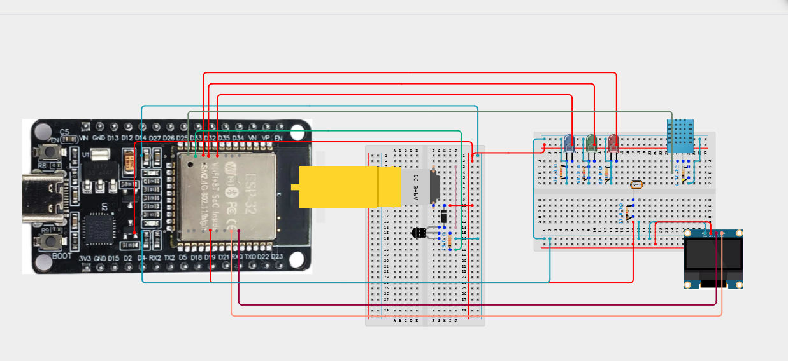
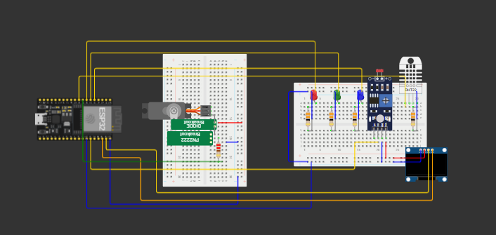
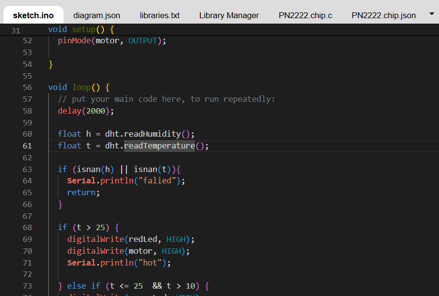

# Weather Station
A breadboard that measures and displays temperature, humidity, and light

# Components
- DHT11: To measure the temperature and humidity
- Photoresistor: To measure the light (sunny, outcast, dark)
- LEDs: To show the temperature (blue for cold, green for mild, and red for hot)
- A display: To display the temperature, humidity, and sky condition
- A fan: To cool the use when the temperatures are too hot.

# Sites
- arduino IDE, Wokwi, cirkitdesigner

# Note
I am not sure if the code and breadboard layout actually work, since a lot depends on the DHT11 and Photoresistor data that don't give values during simulations. I can ask my Engineering teacher later this week to see if there are any issues she sees. There are not any compiling errors though.